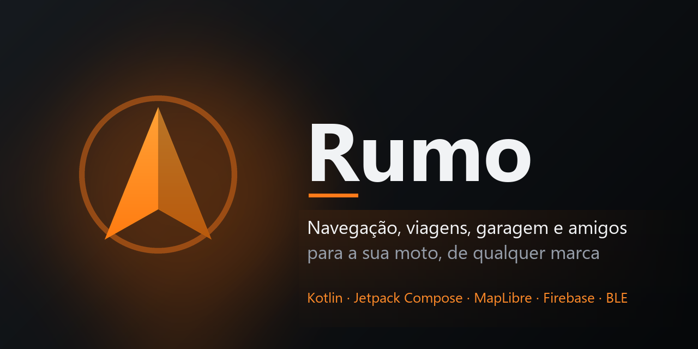

<p align="center">
  
</p>

<p align="center">
  <a href="https://github.com/arthurbritol/rumo/actions/workflows/ci.yml"></a>
  
  
  
  
</p>

# Rumo

App Android para a **Royal Enfield Hunter 350**: mapa com busca de destino, rotas pensadas para moto, navegação
curva a curva com voz, gravação de viagens, controle de abastecimento e manutenção, mapas offline e envio da
navegação ao **Tripper Pod** por Bluetooth. Tudo fica no celular, sem backend e sem conta. Não modifica o Waze.

## Recursos

**Mapa e navegação**
- Mapa em tela cheia (MapLibre + OpenFreeMap, sem chave de API), claro ou escuro conforme o sistema.
- Busca de destino (Photon/OpenStreetMap) com favoritos e recentes instantâneos, distância até cada resultado e
  atalhos (posto, restaurante, mecânica…). Toque longo no mapa escolhe um ponto.
- Rotas para moto (Valhalla): *mais rápida*, *estradas e curvas*, *sem pedágio* e *sem terra*, com alternativas.
- Navegação curva a curva com voz em pt-BR, recálculo ao sair da rota e gravação automática da viagem.
- Funciona com GPS, Wi-Fi ou antenas; avisa quando está sem internet e refaz a rota sozinho quando ela volta.

**Viagens**
- Histórico com mapa do trajeto colorido por velocidade, altimetria e estatísticas (distância, tempo em
  movimento, paradas, velocidade média e máxima). Também grava viagem livre, sem destino.

**Garagem**
- Hodômetro, combustível (km/l, custo por km, autonomia, gráfico) e manutenção por km e/ou dias.
- Lembretes por notificação ao chegar perto do vencimento e ao vencer.
- Mapas offline: uma região ao redor de você ou o corredor de uma rota (estilos claro e escuro).

**Paradas por autonomia**
- Na pré-visualização, o app estima o combustível restante (último tanque cheio + consumo) e, se a rota não cabe
  na autonomia (com 15% de folga), sugere onde abastecer, lista postos perto desse ponto e recalcula a rota
  passando pelo escolhido.

**Tripper Pod**
- Conexão Bluetooth, PIN no primeiro uso, reconexão automática e bússola.
- Na navegação, o Pod mostra a manobra, a distância e a chegada, o tempo ou a distância restantes.
- O protocolo foi validado apenas no Pod da Meteor 350. Na Hunter 350 a compatibilidade é esperada, mas não
  verificada: teste com a moto parada antes de depender dele.

## Instalação

Baixe o APK na aba [Releases](https://github.com/arthurbritol/rumo/releases) (ou gere o seu, abaixo) e instale:

```bash
adb install -r app/build/outputs/apk/release/app-release.apk
```

Requer Android 8.0+ e celular arm64. Instala direto, sem Play Store. Depois da primeira instalação o app avisa
sozinho quando sai uma release nova (consulta o GitHub ao abrir, no máximo a cada 6 h) e atualiza com um toque.

## Desenvolvimento

Requer JDK 17+ (o JBR do Android Studio serve) e o Android SDK 36.

```bash
./gradlew test                  # testes unitários (JVM)
./gradlew :app:assembleRelease  # APK em app/build/outputs/apk/release/
```

O Gradle 8.14 não roda no JDK 25: se o `java` do PATH for o 25, defina `JAVA_HOME` para um JDK 17–21.

Mais de 130 testes cobrem o protocolo do Pod (vetores reais), o motor de navegação (com respostas reais das
APIs), as estatísticas de viagem, combustível, manutenção e lembretes. O CI roda tudo a cada push.

## Arquitetura

Módulos JVM puros (`core-model`, `pod-protocol`, `navigation`) concentram a lógica e são testáveis sem aparelho;
o Android entra em `pod-ble`, `trips`, `maintenance` e `app`. Detalhes, diagrama e decisões em
[docs/ARQUITETURA.md](docs/ARQUITETURA.md).

## Serviços e créditos

Gratuitos e de uso justo; para uso intenso, hospede o seu próprio Valhalla e Photon.

- Mapas: [OpenFreeMap](https://openfreemap.org) e [MapLibre](https://maplibre.org), dados © contribuidores do
  [OpenStreetMap](https://www.openstreetmap.org/copyright)
- Rotas: [Valhalla](https://github.com/valhalla/valhalla) (servidor público do OSM)
- Busca: [Photon](https://photon.komoot.io) (Komoot)
- Protocolo do Pod: baseado no [WazeTripper](https://github.com/jnsdias/wazetripper) (Apache-2.0) — veja
  [NOTICE.md](NOTICE.md)

## Contribuir

Veja [CONTRIBUTING.md](CONTRIBUTING.md). As mudanças estão no [CHANGELOG](CHANGELOG.md); problemas de
segurança, em [SECURITY.md](SECURITY.md).

## Licença

[Apache-2.0](LICENSE). Projeto independente, sem afiliação com a Royal Enfield.
