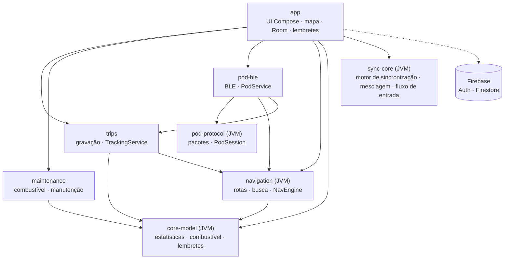

# Arquitetura

Projeto Gradle multi-módulo. A lógica de negócio vive em módulos **JVM puros**, testáveis sem aparelho; o
Android entra só nas bordas (GPS, Bluetooth, banco, interface).

## Módulos

| Módulo | Responsabilidade |
|---|---|
| `core-model` | `TrackPoint`, `TripStatsAccumulator` (filtros de GPS, distância, tempo em movimento, paradas, altimetria com histerese), `FuelMath`, `MaintenanceMath`, `FuelPlanner`, `FuelParityMath`, `MaintenanceReminders`, `GeoBox` |
| `pod-protocol` | Pacotes de 20 bytes do Tripper Pod (18 de payload + CRC-16/CCITT-FALSE), handshake/PIN/hora, bússola, navegação, ícones, `PodSession` (keepalive e escritas serializadas) |
| `pod-ble` | `BlePodLink` (cliente GATT **e** servidor GATT local), `PodService` em primeiro plano com reconexão automática |
| `navigation` | `ValhallaClient` (custo `motorcycle`), `PhotonGeocoder`, `FuelStationFinder` (Overpass), `AnpFuelPayload` (DTOs e parser JSON), `NavEngine` (projeção na polilinha, fora de rota, recálculo), `NavAnnouncer` (voz), `PodManeuvers` (Valhalla → ícones do Pod) |
| `trips` | Entidades Room, `TripRecorder`, `TrackingService` (serviço de localização em primeiro plano), `AndroidLocationSource` |
| `maintenance` | Entidades e DAO de abastecimento, itens de manutenção e hodômetro |
| `sync-core` | JVM puro: pacote `app.hunter.social` (amigos, rolê e localização compartilhada com `LiveLocation`, `LocationPermission`) e `SyncEngine` (baixa, mescla e sobe), `merge`/`mergeOdometer` (último a escrever vence, sem duplicar), `LocalStore`/`RemoteStore` (interfaces), `OnboardingFlow` (ordem da primeira abertura), `BikeCatalog` |
| `app` | `AppDatabase` (Room v4), `HunterViewModel`, telas Compose (Design System Novare e ícones Font Awesome), `HunterMap` (MapLibre, marcadores de amigos e postos ANP), `FuelPriceRepository`, `FuelPriceSyncWorker`, `FuelStationCard`, `OfflineMaps`, `ReminderWorker`; conta e sincronização (`AccountGraph`, `AuthRepository`, `FirebaseAuthGateway`, `RoomLocalStore`, `FirestoreRemoteStore`, `SyncScheduler`), social e localização compartilhada (`SocialGraph`, `LiveLocationPublisher`, `FirestoreSocialStore`) e telas de entrada e perfil |

## Decisões

- **Um banco só.** O `AppDatabase` mora no `app` e reúne as entidades dos módulos; os serviços acham o
  `TripStore` pela `Application`.
- **Estado compartilhado por singletons** (`TrackingStatus`, `PodStatus`, `NavStatus`): a UI e os serviços em
  primeiro plano observam os mesmos fluxos, sem acoplamento direto.
- **Mapa sempre montado.** O `MapView` fica sob todas as abas; trocar de aba não recria o mapa nem refaz os tiles.
- **Rede tolerante.** Tempos limite separados (conexão 8 s, leitura 25 s; busca 8 s), novas tentativas com pausa
  crescente, conexão reaproveitada e cache da busca. Mapa baixado e gravação funcionam sem internet.
- **GPS em duas camadas.** O mapa aceita posição de rede e a última conhecida; a gravação usa só GPS.

## Conta e sincronização

A conta é **opcional**. O `sync-core` não conhece Room nem Firestore: o `app` fornece os adaptadores
(`RoomLocalStore`, `FirestoreRemoteStore`) e o `SyncEngine` só compara versões.

- **Dados na conta** (Firestore, `usuarios/{uid}`): perfil e moto, hodômetro, abastecimentos, itens de manutenção,
  locais favoritos, resumo de cada viagem (sem os pontos) e a preferência de voz. Regras em
  `firebase/firestore.rules`: só o dono lê e grava, com testes de emulador.
- **Só no aparelho:** o trajeto completo das viagens (pontos do GPS), locais recentes, mapas offline, o pareamento
  do Pod e as demais preferências. Uma viagem restaurada da nuvem aparece no histórico sem o mapa.
- **Registros sincronizáveis** têm id global (`gid`), data de alteração e marca "sujo" (Room v3). Apagar deixa uma
  lápide, para a exclusão também chegar aos outros aparelhos. A marca é limpa por versão: uma edição feita durante
  a sincronização continua pendente.
- **Mesclagem:** último a escrever vence (por data da alteração, com limite para relógio no futuro); registros
  iguais criados em aparelhos diferentes (mesma chave) viram um só. Quem usava sem conta e entra numa conta mantém
  os dados.
- **Quando sincroniza:** `AccountGraph` liga um observador no banco (qualquer alteração local com algo pendente
  pede um sync), o `SyncScheduler` agrupa pedidos em 5 s e roda um sync por vez, e a volta da internet dispara um
  sync. Sem usuário logado nada sincroniza. Offline o app funciona normalmente e tudo sobe depois.
- **Uma instância por processo:** o `PerUserRemoteStore` resolve o uid a cada chamada e recria o armazenamento
  remoto quando a conta muda.
- **Sair** só é permitido sem nada pendente e limpa os dados do aparelho; **apagar a conta** exige reautenticar a
  MESMA conta (o Google usa `reauthenticate`, que recusa outra conta), roda com o uid fixado, usa uma marca local (com
  o uid) e outra na nuvem, e é retomada ao abrir o app se for interrompida, antes de qualquer sync. A marca na nuvem
  (`config/exclusao`, só `pending: true`) é **permanente**: um segundo aparelho ainda logado na conta apagada nunca
  reenvia os dados dele; ao ver a marca ele conclui a exclusão e sai da conta localmente.
- **Sem `google-services.json`** o Firebase não é inicializado (`AccountConfig.isAvailable` falso): o app é só
  visitante e o login fica desabilitado.

## Amigos e rolê

Também opcional e só com conta. A lógica mora no `sync-core` (pacote `app.hunter.social`): `SocialStore` (interface),
`SocialEngine` (busca, convites, amizades, bloqueios, rolês), `RolePlanner` (média, alcance sugerido e avisos),
`WeekMath` (semana de segunda a domingo no fuso de quem lê) e `SearchKey` (chave de busca sem acento, minúscula).
O `app` (pacote `app.hunter.app.social`) traz o `FirestoreSocialStore` (adaptador), o `SocialPublisher` (publica
perfil público e atividade), o `SocialGraph` (ponto único: só cria a sessão com Firebase disponível, usuário logado e
sem exclusão pendente), o `SocialViewModel`/`SocialUiMapper` e as telas (`FriendsScreen`, `RoleScreens`).

- **Coleções** (Firestore, fora de `usuarios/`): `busca/{uid}` (índice por nome, leitura por qualquer conta, consulta
  limitada a 20), `perfisPublicos/{uid}` e `atividade/{uid}` (só o dono e amigos leem), `convites/{de_para}`,
  `amizades/{a_b}` (par ordenado; criada só por quem recebeu o convite, no mesmo lote que apaga o convite),
  `bloqueios/{quem_bloqueado}` (só quem bloqueia enxerga) e `roles/{id}` com a subcoleção `membros/{uid}`
  (estado, orçamento e custo por km de cada um).
- **Segurança só por regras:** não há servidor nem Functions; tudo é validado em `firebase/firestore.rules` e
  coberto por testes de emulador por caminho. Limites: 50 amigos, 10 pessoas por rolê.
- **Rolê:** criado num lote único (rolê + membros); o campo `expiraEm` (7 dias) tem política de TTL, e o app também
  fecha rolês vencidos e renova o do criador ao abri-lo.
- **Sem internet** a aba mostra o último dado e um aviso; nada social é guardado no Room.
- **Apagar conta** remove também o conteúdo social, de forma retomável. A marca de exclusão
  (`usuarios/{uid}/config/exclusao`) é permanente e as regras negam escrever `busca`, `perfisPublicos` e `atividade`
  depois dela; no aparelho, a limpeza espera a publicação em andamento terminar (trinco do `SocialGraph`).
- **Busca por nome:** ao abrir (e antes de publicar) o aparelho confere `perfisPublicos.searchable`; só `true` conta como
  "Sim" já dado em outro aparelho (e é adotado). `false` não prova resposta, pois o perfil sai com `false` enquanto ninguém
  respondeu; então a pergunta continua para quem nunca respondeu e o perfil segue privado.
- **Custo de leituras:** na partida só convites e rolês são observados (o marcador precisa deles). Os amigos
  (2 consultas mais 2 leituras por amigo) só carregam com a aba na tela e são relidos ao voltar ao app ou reabrir a aba,
  no mínimo a cada 60 s; a busca usa os amigos em memória e um cache de bloqueados.

### Limitações conhecidas do social

Decisões adiadas de propósito (backlog); nenhuma expõe dados que as regras não permitam.

- **Validade do rolê (M2):** o rolê vencido mostra "abra para renovar", mas o app o encerra na próxima abertura; e a
  validade conta da criação ou da última abertura do criador, não de "7 dias sem atividade".
- **Custo por km (M6):** é a média histórica de R$/km dos abastecimentos (`avgCostPerKm`), não o consumo km/l com o
  preço do último abastecimento.
- **Dados órfãos (M7):** quando o TTL do Firestore apaga um rolê, os documentos de `membros` (orçamento e custo) ficam
  órfãos, inclusive de quem apagou a conta. Hoje são ilegíveis pelas regras; a limpeza exigiria uma Cloud Function.
- **Desbloquear (M8):** não há tela para desbloquear. Bloquear quem já está bloqueado faz `set` em documento existente
  (um update que as regras negam), e o app mostra "Não deu para concluir".
- **Bloqueio e rolês em comum (M10):** bloquear não tira ninguém dos rolês em comum; o bloqueado continua vendo o que
  os participantes publicaram ali.
- **Nome do membro (M13):** o próprio membro pode mudar `nome` no rolê para qualquer texto (as regras só validam
  tamanho); só o criador deveria gravá-lo.
- **Criação de rolê (M14):** `createRole` lê os perfis dos amigos (`friends()`, 2 leituras por amigo) só para pegar nomes
  que o `SocialViewModel` já tem em memória.
- **Convite de quem não está na busca (M9):** aparece como "Alguém quer ser seu amigo"; mostrar o nome exigiria um
  campo `deNome` no convite e mudar a regra.
- **Escolha da busca sem data:** um "Não" não é visível na nuvem (fica igual a "nunca respondeu"), então outro aparelho
  pergunta de novo; e um "Sim" publicado em outro aparelho vale ao abrir, mesmo que este tenha respondido "Não" antes.

## Localização compartilhada com amigos (Projeto 3)

Compartilhamento de posição geográfica em tempo real com amigos autorizados, condicionado estritamente à moto conectada via Bluetooth (Tripper Pod). Sem moto conectada, nada é transmitido para a nuvem.

### Coleções no Firestore
- **`permissoesLocalizacao/{deUid_paraUid}`**: concessão unidirecional em que `deUid` autoriza `paraUid` a ver sua localização.
  - Campos: `de` (string), `para` (string), `criadoEm` (epoch ms opcional).
  - Regras: criação restrita a usuários autenticados onde `de == request.auth.uid`, `de != para` e existe amizade mútua (`amigos(de, para)`). Leitura e exclusão permitidas a ambas as pontas (`de` ou `para`).
- **`localizacoes/{uid}`**: coordenada ativa da moto do usuário `uid`.
  - Campos: `latitude` (-90..90), `longitude` (-180..180), `bearing` (0..360 ou nulo), `speedKmh` (>= 0 ou nulo) e `updatedAtMs` (epoch ms recente).
  - Regras: escrita e exclusão restritas ao dono (`request.auth.uid == uid`), negadas se houver exclusão de conta pendente. Leitura permitida apenas para o dono ou amigos mútuos que possuam documento ativo em `permissoesLocalizacao/{uid_leitor}`.

### Ciclo de vida e `LiveLocationPublisher`
O `LiveLocationPublisher` (no módulo `app`, gerenciado pelo `SocialGraph`) opera de forma totalmente reativa:
1. **Gatilhos de transmissão**:
   - Observa `PodStatus.state`: a transmissão só é habilitada quando o Pod está na fase `PodPhase.CONNECTED`.
   - Observa `observeGrantedPermissions`: requer pelo menos um amigo autorizado (`grantedPermissions.isNotEmpty()`).
   - Se o Pod desconectar ou a lista de permissões esvaziar, o publisher cancela a coleta e executa `SocialStore.clearLocation()`, deletando imediatamente `localizacoes/{uid}` no Firestore.
2. **Filtragem e cota (Spark)**:
   - Coleta pontos de GPS via `LocationSource` (`AndroidLocationSource`).
   - Só emite nova coordenada para o Firestore se decorreram pelo menos **30 segundos** desde a última escrita OU se o deslocamento foi superior a **100 metros**.
3. **Tolerância a desconexões abruptas**:
   - Se o aparelho desligar sem rede ou sem chance de invocar `clearLocation()`, o leitor no cliente descarta qualquer coordenada com `updatedAtMs` mais antigo que **5 minutos** (critério de inatividade), ocultando o marcador de amigo offline.

### Visualização na UI
- **Aba Amigos (`FriendsScreen`)**:
  - Cada card de amigo possui um interruptor individual de "Compartilhar localização" que cria ou apaga o documento `permissoesLocalizacao/{meuUid_amigoUid}`.
  - Amigos que estão com moto conectada e nos autorizaram exibem o badge destacado **"Na estrada"** e o botão **"Ver no mapa"**.
- **Aba Mapa (`HunterMap` / `MapScreen`)**:
  - O mapa observa as localizações ativas dos amigos autorizados enquanto a aba estiver visível.
  - Desenha marcadores com ícone estilizado de moto apontando no sentido do deslocamento (`bearing`), acompanhados pelo nome do amigo e texto relativo de tempo decorrido (ex: "Ana • agora", "há 1 min", etc.).
  - Tocar em "Ver no mapa" na aba Amigos dispara um evento via `SocialViewModel.focusFriendOnMapEvent` que alterna para a aba Mapa e centraliza suavemente a câmera na coordenada da moto.

### Exclusão de conta
- No fluxo de exclusão de conta (`deleteAllUserData`), `FirestoreSocialStore.deleteAllSocial` apaga o documento `localizacoes/{uid}` e remove todas as concessões em `permissoesLocalizacao` onde o usuário é remetente (`de`) ou destinatário (`para`), não deixando dados órfãos.

## Preços de combustíveis e dados da ANP (Projeto 6)

Integração com a Série Histórica de Preços de Combustíveis da ANP (Agência Nacional do Petróleo, Gás Natural e Biocombustíveis) para fornecer referências de preços e identificação de postos com operação 100% offline, projetada especificamente para o uso em viagens e estradas sem conectividade.

### Arquitetura Offline-First (Room v4)
- **Fonte Primária Local:** Diferente de abordagens baseadas em consultas dinâmicas à Overpass API (que sofrem com rate limits/HTTP 429 e dependência de sinal móvel), todos os postos georreferenciados e as estatísticas de preços residem localmente no `AppDatabase` (versão 4 via `MIGRATION_3_4`).
- **Tabelas do Banco Local:**
  - `anp_stations`: armazena postos com coordenadas (`lat`, `lon`), bandeira, endereço e os preços coletados na bomba (gasolina comum, aditivada, etanol e diesel S10).
  - `anp_city_stats`: médias municipais consolidadas por chave da cidade (`cityKey`), com centróides geográficos e valores médios/mínimos/máximos de cada combustível.
  - `anp_state_stats`: médias estaduais consolidadas por UF, com centróides para referência regional em rodovias ou municípios sem amostragem direta.
- **Consultas Espaciais Eficientes:** O mapa executa consultas por *Bounding Box* (`latMin <= lat <= latMax AND lonMin <= lon <= lonMax`) indexadas em `(lat, lon)` e `cityKey`, retornando entidades em poucos milissegundos sem bloquear a thread principal de renderização.

### Hierarquia de Resolução de Preços em 3 Níveis
Para garantir transparência e precisão em qualquer ponto do território nacional, o sistema adota uma resolução em cascata:
1. **Nível 1 (Posto Individual ANP):** Caso o posto selecionado conste na amostragem semanal da ANP, exibe os valores exatos apurados na bomba e a data da última coleta.
2. **Nível 2 (Média Municipal):** Caso o posto pertença a um município coberto pela pesquisa mas não tenha sido visitado na semana, calcula e exibe a média apurada para a cidade (ex: `"~R$ 5,82 · Média de Recife/PE"`).
3. **Nível 3 (Média Estadual / UF):** Em áreas rurais, rodovias interestaduais ou municípios não contemplados na amostragem semanal, utiliza o centróide mais próximo para determinar o Estado e exibe a média estadual consolidada (ex: `"~R$ 5,85 · Média estadual (PE)"`).

### Pipeline ETL e GitHub Actions
- **Script ETL (`scripts/sync_anp_fuel.py`):** Script em Python executado no backend de CI que realiza:
  - Download automático das séries históricas de preços dos portais de dados abertos do governo federal (`gov.br/anp`).
  - Cruzamento de dados com o extrato de postos do OpenStreetMap Brasil (`amenity=fuel`) e bases de centróides municipais do IBGE.
  - Agregação estatística de médias, mínimos e máximos por município e por UF.
  - Compactação dos dados tratados em formato GZIP (`anp-fuel-latest.json.gz`), resultando em um payload ultraleve (< 1.5 MB) para distribuição.
- **Workflow Semanal (`.github/workflows/sync-anp.yml`):** Executado automaticamente aos domingos via GitHub Actions (com suporte a `workflow_dispatch` manual), publicando o asset atualizado via GitHub Releases sem custos de infraestrutura ou servidores dedicados.
- **Seed Inicial Embarcado:** O aplicativo inclui nos assets (`assets/anp_fuel_seed.json.gz`) um pacote pré-carregado com as 27 capitais e estados, garantindo dados disponíveis imediatamente na primeira instalação, mesmo antes de qualquer sincronização de rede.

### Termômetro de Paridade Etanol vs. Gasolina (`FuelParityMath`)
- Localizado no módulo `core-model` (JVM puro), implementa a regra energética dos 70% de paridade (`PARITY_THRESHOLD = 0.70`):
  - Razão calculada como `etanolPrice / gasolinaPrice`.
  - Se a razão for $\le 0.70$, o etanol é vantajoso financeiramente em relação ao rendimento calórico médio dos motores flex.
  - Provê funções semânticas (`formatParityDescription`) para exibição em badges visuais Novare (`StatusPill`), informando ao motociclista a porcentagem exata e qual combustível compensa (ex: *"Etanol a 68% da gasolina · Etanol compensa"* ou *"Etanol a 73% da gasolina · Gasolina compensa"*).

### Repositório e Sincronização (`FuelPriceRepository` e `FuelPriceSyncWorker`)
- **`FuelPriceRepository` (`app.hunter.app.fuel`):**
  - Gerencia o acesso ao `AnpFuelDao` e coordena a hierarquia de resolução em 3 níveis.
  - Executa resolução por raio esférico (`Geo.distanceM`) para identificar o município ou estado mais próximo a partir da coordenada GPS do dispositivo.
  - Provê métodos reativos baseados em corrotinas para busca por *Bounding Box*, enriquecimento de postos do mapa e sugestões para a garagem.
- **`FuelPriceSyncWorker`:**
  - `CoroutineWorker` do Android Jetpack WorkManager com execução periódica (semanal) configurada para rodar preferencialmente em redes Wi-Fi e com bateria recarregando.
  - Realiza o download seguro do arquivo `anp-fuel-latest.json.gz`, descompacta o fluxo de bytes em memória usando `GZIPInputStream` e persiste os novos lotes no Room via transações atômicas no `AnpFuelDao`.

### Componentes de Interface (Design System Novare)
- **Marcadores no `HunterMap`:**
  - Renderizados com o ícone Font Awesome `fa_gas_pump` e balão de preço contrastante em cores Midnight Navy / Clean Slate.
  - Integração com `FuelMapCoordinator` para gerenciar a visibilidade da camada de postos e atualizar o conjunto de marcadores conforme a câmera do mapa se desloca.
  - Toque no marcador seleciona o posto e abre imediatamente o card de detalhes sem recarregar o mapa.
- **Card Detalhado (`FuelStationCard`):**
  - Componente de bottom sheet construído sobre o `HCard` do Novare Design System.
  - Cabeçalho com nome do posto, bandeira com `SquircleIcon`, endereço e distância em tempo real em relação ao usuário.
  - Tabela comparativa de combustíveis em grid com suporte a Gasolina Comum, Aditivada, Etanol e Diesel S10.
  - Termômetro de paridade com `StatusPill` verde/âmbar contextualizando a relação Etanol x Gasolina.
  - Ações diretas com botões Novare (`RumoPrimaryButton` para "Navegar até o posto" via `NavEngine` e `RumoSecondaryButton` para "Adicionar parada").
- **Sugestão Inteligente na Garagem (`AddFuelDialog` em `GarageScreen`):**
  - Ao abrir o diálogo de registro de abastecimento com GPS disponível, o app busca a cidade ou estado mais próximo via `FuelPriceRepository.getNearestCityStats`.
  - Exibe um chip interativo com a média recente de preço do litro (ex: *"Preço médio recente em Recife: R$ 5,82/L"*).
  - Um único toque no chip preenche o campo de preço por litro no formulário, agilizando o registro e prevenindo erros de digitação.

## Interface e Design System (Novare)

A interface do Rumo é desenvolvida em Jetpack Compose e adota os padrões do **Design System Novare**:

- **Paleta Semântica Novare**:
  - **Midnight Navy (Tema Escuro)**: otimizado para pilotagem noturna e ambientes de baixa luminosidade. Fundo principal azul-marinho profundo (`#0B111D`), superfícies em camadas tonais (`#141C2B`, `#1E2D44`), texto primário de alto contraste (`#F8FAFC`) e acentos funcionais em laranja (`#FF7A1A`), ciano (`#38BDF8`) e âmbar (`#F59E0B`).
  - **Clean Slate (Tema Claro)**: projetado para visibilidade sob luz solar direta em suporte de guidão. Fundo neutro arejado (`#F1F5F9`), superfícies claras contrastantes (`#FFFFFF`, `#E2E8F0`), texto escuro (`#0F172A`) e cores com contraste ajustado para superfícies claras (`#EA580C`, `#0284C7`).
- **Formas e Geometria**:
  - Cantos arredondados contínuos com `SquircleIcon` (squircle 44dp, raio 12dp), `HCard` (cantos 22dp), botões (16dp), campos de busca (14dp) e badges (pílula 50%/10dp), eliminando cantos pontiagudos ou quinas duras.
- **Componentes Base Unificados (`app.hunter.app.ui.Components`)**:
  - `HCard`: container com cantos arredondados de 22dp, fundo de superfície tonal e micro-borda suave (`outline` com opacidade 0.5f).
  - `SquircleIcon`: container quadrado arredondado (44dp, cantos 12dp) para ícones Font Awesome ou Material com fundo colorido.
  - `HeroMetricCard`: cartão hero para grandes instrumentos (hodômetro, resumo do rolê, autonomia) com suporte a ação contextual alinhada à direita.
  - `RumoSearchField`: campo de busca estilizado de 48dp com cantos de 14dp, área de toque acessível (36dp) e ícone Font Awesome integrado.
  - `RumoPrimaryButton`: botão de ação primária com altura de 54dp, cantos de 16dp, gradiente Novare (`#FF7A1A` -> `#EA580C`) e suporte a ícone e estado desabilitado.
  - `RumoSecondaryButton`: botão de ação secundária com altura de 50dp, outline tonal, cantos de 16dp e atenuação de 0.38f para texto e borda quando desabilitado.
  - `StatusPill`: pílula compacta de status/tendência com fundo colorido e tipografia destacada.
  - `RumoBadge`: badge compacto com cantos arredondados para identificadores contextuais (ex: "Você").
- **Ícones Vetoriais Font Awesome 6 (`app/src/main/res/drawable/fa_*.xml`)**:
  - Coleção vetorial em arquivos XML de recursos (`app/src/main/res/drawable/fa_*.xml`) com mais de 40 glifos de alta legibilidade para navegação, telemetria, controles e ações.
  - Cobre navegação (bússola, rota, velocímetro, camadas, postos), status da moto (combustível, bateria, chave inglesa, odômetro), social (amigos, capacete, grupo, sino de notificações) e ações gerais (busca, engrenagem, fechar, voltar).

## Pod (BLE)

Dispositivo `RE_DISP`, serviço `01FF0100-BA5E-F4EE-5CA1-EB1E5E4B1CE0`. O celular é cliente GATT e também expõe
um servidor GATT local. Handshake de retomada (`21 00` → hora → 2× ping) ou de pareamento novo (`21 01` + PIN);
watchdog de ~5 s (ping após 2 s ocioso, tela reenviada a cada 2 s). O protocolo vem do
[WazeTripper](https://github.com/jnsdias/wazetripper) (Apache-2.0) e foi validado apenas num Pod da Meteor 350.

## Serviços externos

| Serviço | Uso |
|---|---|
| OpenFreeMap | Tiles vetoriais e estilos (claro e escuro) |
| Valhalla (valhalla1.openstreetmap.de) | Rotas para moto, com alternativas e paradas |
| Photon (photon.komoot.io) | Busca de endereços e lugares |
| Overpass | Postos de combustível (`amenity=fuel`) para busca online sob demanda |
| Dados Abertos ANP / GitHub Releases | Série histórica de preços de combustíveis compactada (`anp-fuel-latest.json.gz`) |
| Firebase (Authentication + Firestore, plano gratuito) | Conta, sincronização e amigos/rolê, só quando o `google-services.json` está no build; sem Storage nem Functions |

Todos são gratuitos e de uso justo; para uso intenso, hospede o seu próprio Valhalla e Photon.

## Testes

Mais de 450 testes unitários na JVM (mais os testes das regras do Firestore, no emulador): vetores reais do protocolo do Pod, motor de navegação percorrendo uma rota
real, respostas reais gravadas das APIs, estatísticas de viagem, combustível, manutenção, lembretes, hodômetro, mesclagem e motor de sincronização, regras de conta,
paridade energética de combustíveis (`FuelParityMath`), parser de payload da ANP, migração Room v3 -> v4 (`Migration3To4`), resolução em 3 níveis do repositório
de postos e componentes visuais do mapa, card de detalhes e tela de garagem.
Rodam no CI a cada push.
