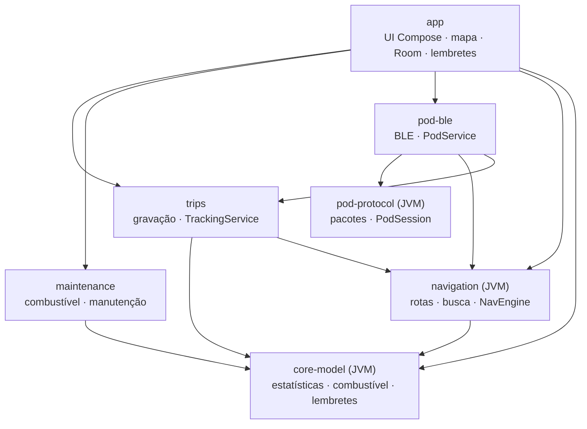

# Arquitetura

Projeto Gradle multi-módulo. A lógica de negócio vive em módulos **JVM puros**, testáveis sem aparelho; o
Android entra só nas bordas (GPS, Bluetooth, banco, interface).

## Módulos

| Módulo | Responsabilidade |
|---|---|
| `core-model` | `TrackPoint`, `TripStatsAccumulator` (filtros de GPS, distância, tempo em movimento, paradas, altimetria com histerese), `FuelMath`, `MaintenanceMath`, `FuelPlanner`, `MaintenanceReminders`, `GeoBox` |
| `pod-protocol` | Pacotes de 20 bytes do Tripper Pod (18 de payload + CRC-16/CCITT-FALSE), handshake/PIN/hora, bússola, navegação, ícones, `PodSession` (keepalive e escritas serializadas) |
| `pod-ble` | `BlePodLink` (cliente GATT **e** servidor GATT local), `PodService` em primeiro plano com reconexão automática |
| `navigation` | `ValhallaClient` (custo `motorcycle`), `PhotonGeocoder`, `FuelStationFinder` (Overpass), `NavEngine` (projeção na polilinha, fora de rota, recálculo), `NavAnnouncer` (voz), `PodManeuvers` (Valhalla → ícones do Pod) |
| `trips` | Entidades Room, `TripRecorder`, `TrackingService` (serviço de localização em primeiro plano), `AndroidLocationSource` |
| `maintenance` | Entidades e DAO de abastecimento, itens de manutenção e hodômetro |
| `app` | `AppDatabase` (Room v2), `HunterViewModel`, telas Compose, `HunterMap` (MapLibre), `OfflineMaps`, `ReminderWorker` |

## Decisões

- **Um banco só.** O `AppDatabase` mora no `app` e reúne as entidades dos módulos; os serviços acham o
  `TripStore` pela `Application`.
- **Estado compartilhado por singletons** (`TrackingStatus`, `PodStatus`, `NavStatus`): a UI e os serviços em
  primeiro plano observam os mesmos fluxos, sem acoplamento direto.
- **Mapa sempre montado.** O `MapView` fica sob todas as abas; trocar de aba não recria o mapa nem refaz os tiles.
- **Rede tolerante.** Tempos limite separados (conexão 8 s, leitura 25 s; busca 8 s), novas tentativas com pausa
  crescente, conexão reaproveitada e cache da busca. Mapa baixado e gravação funcionam sem internet.
- **GPS em duas camadas.** O mapa aceita posição de rede e a última conhecida; a gravação usa só GPS.

## Pod (BLE)

Dispositivo `RE_DISP`, serviço `01FF0100-BA5E-F4EE-5CA1-EB1E5E4B1CE0`. O celular é cliente GATT e também expõe
um servidor GATT local. Handshake de retomada (`21 00` → hora → 2× ping) ou de pareamento novo (`21 01` + PIN);
watchdog de ~5 s (ping após 2 s ocioso, tela reenviada a cada 2 s). O protocolo vem do
[WazeTripper](https://github.com/jnsdias/wazetripper) (Apache-2.0) e foi validado apenas num Pod da Meteor 350.

## Serviços externos

| Serviço | Uso |
|---|---|
| OpenFreeMap | Tiles vetoriais e estilos (claro e escuro) |
| Valhalla (valhalla1.openstreetmap.de) | Rotas para moto, com alternativas e paradas |
| Photon (photon.komoot.io) | Busca de endereços e lugares |
| Overpass | Postos de combustível (`amenity=fuel`) |

Todos são gratuitos e de uso justo; para uso intenso, hospede o seu próprio Valhalla e Photon.

## Testes

Mais de 130 testes unitários na JVM: vetores reais do protocolo do Pod, motor de navegação percorrendo uma rota
real, respostas reais gravadas das APIs, estatísticas de viagem, combustível, manutenção, lembretes e hodômetro.
Rodam no CI a cada push.
