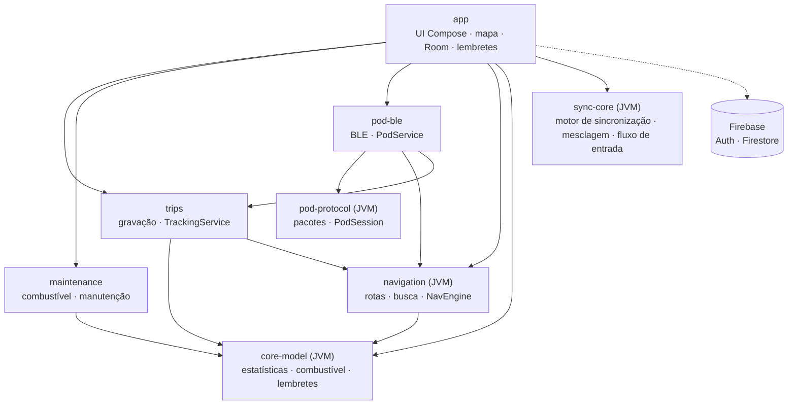

# Arquitetura

Projeto Gradle multi-módulo. A lógica de negócio vive em módulos **JVM puros**, testáveis sem aparelho; o
Android entra só nas bordas (GPS, Bluetooth, banco, interface).

## Módulos

| Módulo | Responsabilidade |
|---|---|
| `core-model` | `TrackPoint`, `TripStatsAccumulator` (filtros de GPS, distância, tempo em movimento, paradas, altimetria com histerese), `FuelMath`, `MaintenanceMath`, `FuelPlanner`, `MaintenanceReminders`, `GeoBox` |
| `pod-protocol` | Pacotes de 20 bytes do Tripper Pod (18 de payload + CRC-16/CCITT-FALSE), handshake/PIN/hora, bússola, navegação, ícones, `PodSession` (keepalive e escritas serializadas) |
| `pod-ble` | `BlePodLink` (cliente GATT **e** servidor GATT local), `PodService` em primeiro plano com reconexão automática |
| `navigation` | `ValhallaClient` (custo `motorcycle`), `PhotonGeocoder`, `FuelStationFinder` (Overpass), `NavEngine` (projeção na polilinha, fora de rota, recálculo), `NavAnnouncer` (voz), `PodManeuvers` (Valhalla → ícones do Pod) |
| `trips` | Entidades Room, `TripRecorder`, `TrackingService` (serviço de localização em primeiro plano), `AndroidLocationSource` |
| `maintenance` | Entidades e DAO de abastecimento, itens de manutenção e hodômetro |
| `sync-core` | JVM puro: pacote `app.hunter.social` (amigos e rolê) e `SyncEngine` (baixa, mescla e sobe), `merge`/`mergeOdometer` (último a escrever vence, sem duplicar), `LocalStore`/`RemoteStore` (interfaces), `OnboardingFlow` (ordem da primeira abertura), `BikeCatalog` |
| `app` | `AppDatabase` (Room v3), `HunterViewModel`, telas Compose, `HunterMap` (MapLibre), `OfflineMaps`, `ReminderWorker`; conta e sincronização (`AccountGraph`, `AuthRepository`, `FirebaseAuthGateway`, `RoomLocalStore`, `FirestoreRemoteStore`, `SyncScheduler`) e telas de entrada e perfil |

## Decisões

- **Um banco só.** O `AppDatabase` mora no `app` e reúne as entidades dos módulos; os serviços acham o
  `TripStore` pela `Application`.
- **Estado compartilhado por singletons** (`TrackingStatus`, `PodStatus`, `NavStatus`): a UI e os serviços em
  primeiro plano observam os mesmos fluxos, sem acoplamento direto.
- **Mapa sempre montado.** O `MapView` fica sob todas as abas; trocar de aba não recria o mapa nem refaz os tiles.
- **Rede tolerante.** Tempos limite separados (conexão 8 s, leitura 25 s; busca 8 s), novas tentativas com pausa
  crescente, conexão reaproveitada e cache da busca. Mapa baixado e gravação funcionam sem internet.
- **GPS em duas camadas.** O mapa aceita posição de rede e a última conhecida; a gravação usa só GPS.

## Conta e sincronização

A conta é **opcional**. O `sync-core` não conhece Room nem Firestore: o `app` fornece os adaptadores
(`RoomLocalStore`, `FirestoreRemoteStore`) e o `SyncEngine` só compara versões.

- **Dados na conta** (Firestore, `usuarios/{uid}`): perfil e moto, hodômetro, abastecimentos, itens de manutenção,
  locais favoritos, resumo de cada viagem (sem os pontos) e a preferência de voz. Regras em
  `firebase/firestore.rules`: só o dono lê e grava, com testes de emulador.
- **Só no aparelho:** o trajeto completo das viagens (pontos do GPS), locais recentes, mapas offline, o pareamento
  do Pod e as demais preferências. Uma viagem restaurada da nuvem aparece no histórico sem o mapa.
- **Registros sincronizáveis** têm id global (`gid`), data de alteração e marca "sujo" (Room v3). Apagar deixa uma
  lápide, para a exclusão também chegar aos outros aparelhos. A marca é limpa por versão: uma edição feita durante
  a sincronização continua pendente.
- **Mesclagem:** último a escrever vence (por data da alteração, com limite para relógio no futuro); registros
  iguais criados em aparelhos diferentes (mesma chave) viram um só. Quem usava sem conta e entra numa conta mantém
  os dados.
- **Quando sincroniza:** `AccountGraph` liga um observador no banco (qualquer alteração local com algo pendente
  pede um sync), o `SyncScheduler` agrupa pedidos em 5 s e roda um sync por vez, e a volta da internet dispara um
  sync. Sem usuário logado nada sincroniza. Offline o app funciona normalmente e tudo sobe depois.
- **Uma instância por processo:** o `PerUserRemoteStore` resolve o uid a cada chamada e recria o armazenamento
  remoto quando a conta muda.
- **Sair** só é permitido sem nada pendente e limpa os dados do aparelho; **apagar a conta** exige reautenticar a
  MESMA conta (o Google usa `reauthenticate`, que recusa outra conta), roda com o uid fixado, usa uma marca local (com
  o uid) e outra na nuvem, e é retomada ao abrir o app se for interrompida, antes de qualquer sync. A marca na nuvem
  (`config/exclusao`, só `pending: true`) é **permanente**: um segundo aparelho ainda logado na conta apagada nunca
  reenvia os dados dele; ao ver a marca ele conclui a exclusão e sai da conta localmente.
- **Sem `google-services.json`** o Firebase não é inicializado (`AccountConfig.isAvailable` falso): o app é só
  visitante e o login fica desabilitado.

## Amigos e rolê

Também opcional e só com conta. A lógica mora no `sync-core` (pacote `app.hunter.social`): `SocialStore` (interface),
`SocialEngine` (busca, convites, amizades, bloqueios, rolês), `RolePlanner` (média, alcance sugerido e avisos),
`WeekMath` (semana de segunda a domingo no fuso de quem lê) e `SearchKey` (chave de busca sem acento, minúscula).
O `app` (pacote `app.hunter.app.social`) traz o `FirestoreSocialStore` (adaptador), o `SocialPublisher` (publica
perfil público e atividade), o `SocialGraph` (ponto único: só cria a sessão com Firebase disponível, usuário logado e
sem exclusão pendente), o `SocialViewModel`/`SocialUiMapper` e as telas (`FriendsScreen`, `RoleScreens`).

- **Coleções** (Firestore, fora de `usuarios/`): `busca/{uid}` (índice por nome, leitura por qualquer conta, consulta
  limitada a 20), `perfisPublicos/{uid}` e `atividade/{uid}` (só o dono e amigos leem), `convites/{de_para}`,
  `amizades/{a_b}` (par ordenado; criada só por quem recebeu o convite, no mesmo lote que apaga o convite),
  `bloqueios/{quem_bloqueado}` (só quem bloqueia enxerga) e `roles/{id}` com a subcoleção `membros/{uid}`
  (estado, orçamento e custo por km de cada um).
- **Segurança só por regras:** não há servidor nem Functions; tudo é validado em `firebase/firestore.rules` e
  coberto por testes de emulador por caminho. Limites: 50 amigos, 10 pessoas por rolê.
- **Rolê:** criado num lote único (rolê + membros); o campo `expiraEm` (7 dias) tem política de TTL, e o app também
  fecha rolês vencidos e renova o do criador ao abri-lo.
- **Sem internet** a aba mostra o último dado e um aviso; nada social é guardado no Room.
- **Apagar conta** remove também o conteúdo social, de forma retomável. A marca de exclusão
  (`usuarios/{uid}/config/exclusao`) é permanente e as regras negam escrever `busca`, `perfisPublicos` e `atividade`
  depois dela; no aparelho, a limpeza espera a publicação em andamento terminar (trinco do `SocialGraph`).
- **Busca por nome:** a fonte da verdade da escolha é `perfisPublicos.searchable`. Ao abrir (e antes de publicar) o
  aparelho confere a nuvem: se já existe, vale a da nuvem; se não, vale a resposta local. Só depois a pergunta é feita.
- **Custo de leituras:** na partida só convites e rolês são observados (o marcador precisa deles). Os amigos
  (2 consultas mais 2 leituras por amigo) só carregam com a aba na tela e são relidos ao voltar ao app ou reabrir a aba,
  no mínimo a cada 60 s; a busca usa os amigos em memória e um cache de bloqueados.

### Limitações conhecidas do social

Decisões adiadas de propósito (backlog); nenhuma expõe dados que as regras não permitam.

- **Validade do rolê (M2):** o rolê vencido mostra "abra para renovar", mas o app o encerra na próxima abertura; e a
  validade conta da criação ou da última abertura do criador, não de "7 dias sem atividade".
- **Custo por km (M6):** é a média histórica de R$/km dos abastecimentos (`avgCostPerKm`), não o consumo km/l com o
  preço do último abastecimento.
- **Dados órfãos (M7):** quando o TTL do Firestore apaga um rolê, os documentos de `membros` (orçamento e custo) ficam
  órfãos, inclusive de quem apagou a conta. Hoje são ilegíveis pelas regras; a limpeza exigiria uma Cloud Function.
- **Desbloquear (M8):** não há tela para desbloquear. Bloquear quem já está bloqueado faz `set` em documento existente
  (um update que as regras negam), e o app mostra "Não deu para concluir".
- **Bloqueio e rolês em comum (M10):** bloquear não tira ninguém dos rolês em comum; o bloqueado continua vendo o que
  os participantes publicaram ali.
- **Nome do membro (M13):** o próprio membro pode mudar `nome` no rolê para qualquer texto (as regras só validam
  tamanho); só o criador deveria gravá-lo.
- **Criação de rolê (M14):** `createRole` lê os perfis dos amigos (`friends()`, 2 leituras por amigo) só para pegar nomes
  que o `SocialViewModel` já tem em memória.
- **Convite de quem não está na busca (M9):** aparece como "Alguém quer ser seu amigo"; mostrar o nome exigiria um
  campo `deNome` no convite e mudar a regra.
- **Escolha da busca sem data:** a nuvem manda ao abrir; duas respostas quase simultâneas em aparelhos diferentes
  ficam com a última a publicar.

## Pod (BLE)

Dispositivo `RE_DISP`, serviço `01FF0100-BA5E-F4EE-5CA1-EB1E5E4B1CE0`. O celular é cliente GATT e também expõe
um servidor GATT local. Handshake de retomada (`21 00` → hora → 2× ping) ou de pareamento novo (`21 01` + PIN);
watchdog de ~5 s (ping após 2 s ocioso, tela reenviada a cada 2 s). O protocolo vem do
[WazeTripper](https://github.com/jnsdias/wazetripper) (Apache-2.0) e foi validado apenas num Pod da Meteor 350.

## Serviços externos

| Serviço | Uso |
|---|---|
| OpenFreeMap | Tiles vetoriais e estilos (claro e escuro) |
| Valhalla (valhalla1.openstreetmap.de) | Rotas para moto, com alternativas e paradas |
| Photon (photon.komoot.io) | Busca de endereços e lugares |
| Overpass | Postos de combustível (`amenity=fuel`) |
| Firebase (Authentication + Firestore, plano gratuito) | Conta, sincronização e amigos/rolê, só quando o `google-services.json` está no build; sem Storage nem Functions |

Todos são gratuitos e de uso justo; para uso intenso, hospede o seu próprio Valhalla e Photon.

## Testes

Mais de 400 testes unitários na JVM (mais os testes das regras do Firestore, no emulador): vetores reais do protocolo do Pod, motor de navegação percorrendo uma rota
real, respostas reais gravadas das APIs, estatísticas de viagem, combustível, manutenção, lembretes, hodômetro, mesclagem e motor de sincronização, regras de conta.
Rodam no CI a cada push.
