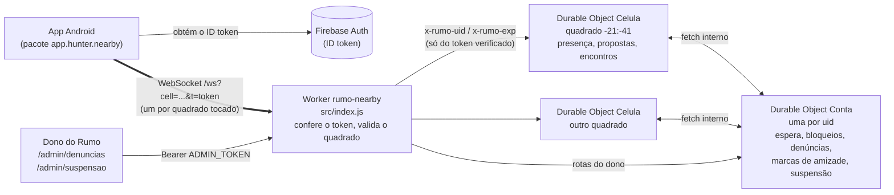

# Rolê por perto

O "Rolê por perto" mostra, em tempo quase real, outros motociclistas do Rumo que estão por perto procurando o mesmo tipo de rolê (ritmo, distância e parada que combinam), **sem revelar quem são nem onde estão de verdade**: cada pessoa aparece só com um id aleatório de sessão e uma posição com desvio de 200 a 400 m. Dá para propor um ponto de encontro, entrar na proposta de outra pessoa, bloquear e denunciar, e virar amigo depois do encontro (se os dois quiserem).

O servidor é um Cloudflare Worker com Durable Objects (pasta `workers/nearby`). O app abre uma conexão WebSocket por quadrado de 1° x 1° que o raio escolhido toca. Documentos relacionados: [spec](superpowers/specs/2026-11-11-role-por-perto-design.md), [roteiro de testes com aparelhos](TESTES-MANUAIS-ROLE-POR-PERTO.md), [conferência da lista "está pronto"](ROLE-POR-PERTO-PRONTO.md).

## Arquitetura



- **Celula**: um Durable Object por quadrado de 1° x 1° (cerca de 111 km). Guarda quem está procurando (sessão anônima, posição real só em memória e nos anexos do socket, posição aproximada para os outros), as propostas e os encontros cujo ponto cai no quadrado. Usa a API de hibernação dos WebSockets e um alarme de 30 s que expira quem ficou 2 minutos sem sinal.
- **Conta**: um Durable Object por `uid`, para o que vale em qualquer lugar: espera de 5 min entre propostas, bloqueios (simétricos), denúncias, marcas de "quero ser amigo" (24 h) e suspensão. Há ainda uma Conta reservada que serve de índice de denúncias para o dono.
- O Firestore **não** participa da posição nem dos encontros; continua cuidando só de conta, amigos e rolês em grupo. A única ponte é o fim do encontro, que entrega o `uid` de quem marcou "quero ser amigo" aos dois lados para o app usar o convite de amizade que já existia.
- O servidor nunca envia `uid`, nome, e-mail, modelo da moto nem posição exata a quem não deve; os clientes só conhecem o id aleatório da sessão.

## Protocolo

Mensagens JSON, uma conexão por quadrado. Limite de 2 KB por mensagem; qualquer coisa fora do formato vira `erro` `mensagem_invalida`. Atualização de posição: **30 s** procurando e **10 s** em encontro (o servidor ignora posições com menos de 10 s de intervalo).

| Do app para o servidor | Campos | Para quê |
|---|---|---|
| `procurar` | `ritmo`, `distancia`, `parada`, `raioKm` (5 a 20) | liga a busca |
| `parar` | | desliga a busca |
| `posicao` | `lat`, `lon`, `rumo`, `vel`, `distKm`, `etaMin` | posição real; vira posição aproximada para os vizinhos |
| `proposta` | `lat`, `lon`, `vagas` (2 a 8) | propõe um encontro no ponto (quadrado do ponto) |
| `cancelar` / `entrar {id}` / `sair` | | gerencia a participação |
| `bloquear {sessao}` / `denunciar {sessao, motivo}` | motivo: `incomodo`, `comportamento`, `falso`, `outro` | segurança; só o id opaco da sessão |
| `amigo {sessao}` / `amigo_ack {uid}` | | "quero ser amigo" e confirmação de entrega |

| Do servidor para o app | Conteúdo |
|---|---|
| `vizinhos` | lista de `{sessao, lat, lon, rumo, ritmo, distancia, parada, combina}` (posição aproximada) |
| `propostas` | propostas abertas no raio: ponto, vagas livres e total, preferências, `combina`; nunca quem propôs |
| `encontro` | ponto, vagas livres, `eu` e participantes (ids opacos; posição aproximada, real a menos de 1 km do ponto; distância e tempo) |
| `fim` | motivo: chegaram, cancelado, expirou, ninguém chegou, saiu |
| `amigo_confirmado` | `uid` do outro, só quando os dois marcaram |
| `erro` | `codigo`: por exemplo `mensagem_invalida`, `nao_procurando`, `posicao_implausivel`, `cheio`, `espera`, `ja_tem_proposta`, `ja_em_encontro`, `ponto_invalido`, `inexistente`, `limite`, `suspenso`, `indisponivel` |

Conexão: `GET /ws?cell=<lat>:<lon>&t=<ID token>` (e `&enc=<id>` para a conexão extra de um encontro). Respostas: 401 sem token ou token inválido, 404 quadrado malformado ou fora do Brasil, 426 sem `Upgrade`, 500 `server not configured`. O token vale 1 h: o app renova e reconecta; o servidor fecha a conexão que passar do `exp` (com tolerância de 300 s para relógio errado).

## Decisões e por que o Firestore não serve

**Por que não o Firestore.** Cada pessoa que escreve a posição precisa ser lida por todos os vizinhos. Com N pessoas na mesma região, cada uma escrevendo a cada 30 s, são N escritas e N x N leituras por intervalo; contando as duas pontas, cerca de 2 x N² leituras por minuto. Com N = 100 isso dá 20.000 leituras por minuto, e a cota gratuita do Firestore (50 mil leituras por dia) acaba em cerca de 3 minutos. Mesmo no plano pago o custo cresce com o quadrado de N. No servidor em tempo real, cada mensagem **enviada pelo celular** é cobrada (20 mensagens = 1 requisição) e as que o servidor **devolve** aos vizinhos não são: o custo cresce com N.

Outras decisões:

- **Quadrados de 1° x 1°, um Durable Object por quadrado**: um raio de até 20 km toca no máximo 4 quadrados (1 na maioria dos casos). Escala acrescentando quadrados, sem reescrever.
- **Estado global por pessoa numa Conta por `uid`**: espera, bloqueios e suspensão valem em qualquer quadrado.
- **Cada encontro vive na Celula do quadrado do ponto**; os participantes abrem uma conexão extra para ela.
- **Posição aproximada**: desvio de 200 a 400 m calculado por HMAC do `uid`, da data e de um segredo do servidor, estável por pessoa e por dia (ligar e desligar não dá desvios diferentes para tirar a média).
- **Posição real só a menos de 1 km do ponto**, dentro do encontro, e só enquanto ele durar.
- **Servidor decide a chegada** (menos de 100 m do ponto) e rejeita posição com velocidade acima de 250 km/h ou salto de mais de 50 km em menos de 60 s.
- **Sem notificação com o app fechado** e sem permissão de localização em segundo plano: o app usa o serviço em primeiro plano que já existia.

## Custo e capacidade medidos

### Limites do plano gratuito (conferidos na página de preços da Cloudflare em 19/11/2026)

| Recurso (Workers/Durable Objects, plano gratuito) | Limite diário |
|---|---|
| Requisições | 100.000 |
| Duração | 13.000 GB-s |
| Linhas lidas no SQLite | 5 milhões |
| Linhas gravadas no SQLite | 100.000 |
| Dados armazenados (SQL), total | 5 GB |

Passando de um limite, as operações daquele tipo **falham com erro** até as 00:00 UTC; o app mostra "Rolê por perto indisponível agora" e tenta de novo. Mensagens de WebSocket recebidas pelo Durable Object contam 20 para 1; as enviadas pelo servidor e os pings de protocolo não são cobrados.

### Como o teste foi feito

`workers/nearby/loadtest/simulate.js`, **local**: sobe `wrangler dev` (workerd, na mesma máquina) com `loadtest/worker.js`, que é o roteador de produção aceitando uma chave de teste no lugar das chaves do Google. O simulador gera um par RSA, assina ID tokens RS256 (um `uid` por conexão) e abre 100 WebSockets no mesmo quadrado (`-21:-41`, posições espalhadas em cerca de 4 km, raio 5 km). Cada um manda `procurar` e depois `posicao` a cada 30 s (desfasados), com deslocamento de até 50 m, e 3 encontros são exercitados (propor, 2 entradas por conexão extra, posição a cada 10 s, cancelar). 5 conexões mandam também uma mensagem inválida a cada 10 s só para medir o tempo de ida e volta (o servidor responde `erro` na hora); essas "sondas" ficam fora das contas de custo.

```
cd workers/nearby
npm install
node loadtest/simulate.js                                   # 100 conexões, 300 s, 3 encontros
node loadtest/simulate.js --conexoes 100 --duracao 300 --json resultado.json
```

Opções: `--conexoes`, `--duracao` (s), `--encontros`, `--intervalo` (s entre posições de quem procura), `--porta`, `--limite-diario`, `--json`. Ele nunca fala com o servidor publicado (a produção exige token real do Firebase e o plano gratuito tem cota diária). Os arquivos `loadtest/.dev.vars` e a pasta de estado temporária são apagados ao fim.

### Resultado (execução completa de 5 minutos, 100 conexões, na máquina de desenvolvimento, Windows 11)

| Medida | Valor |
|---|---|
| Conexões abertas (+ extras de encontro) | 100 (+6) |
| Duração | 304,7 s |
| Mensagens enviadas, como o app | 1.402 (média 276 por minuto: 414, 248, 248, 247, 245; o 1º minuto inclui a abertura e os 3 encontros) |
| Por tipo | `procurar` 100, `posicao` 1.290, `proposta` 3, `entrar` 6, `cancelar` 3 |
| Por pessoa | 2,76 mensagens por minuto (2,45 em regime, sem a abertura) |
| Mensagens recebidas pelos clientes | 15.434 (`vizinhos` 14.269, `propostas` 654, `encontro` 357, `fim` 9, `erro` 145 das sondas) |
| Volume recebido / enviado | cerca de 247 MB / 169 KB (cada lista de vizinhos leva ~100 motos) |
| Erros | **0** (aberturas, sockets, quedas antes da hora, erros de protocolo) |
| Vizinhos vistos por conexão no fim | 98,2 de 99 possíveis |
| Tempo de resposta (ida e volta de uma mensagem inválida, 145 amostras) | p50 56 ms, p95 477 ms, máximo 1.115 ms |
| Abrir uma conexão (inclui conferir o token RS256) | p50 1,15 s, p95 3,68 s (100 conexões abrindo em lotes de 20 num servidor local) |
| Da abertura à 1ª lista de vizinhos | p50 0,52 s, p95 2,61 s |

Uma execução anterior com a mesma configuração (antes de eu corrigir um erro do simulador: os participantes extras saltavam centenas de metros entre posições e o servidor, corretamente, respondia `posicao_implausivel`) teve 1.397 mensagens enviadas, 0 erros de conexão e valores semelhantes.

### Conta de custo (regra 20 para 1)

- No teste de 5 min: 1.402 mensagens / 20 = **70 requisições** de Durable Object, mais 106 conexões abertas = **176 requisições**.
- Projeção para 100 pessoas procurando 3 h por dia, com a taxa medida por pessoa (2,76 mensagens por minuto): 49.700 mensagens por dia = 2.485 requisições + 100 conexões = **cerca de 2.585 requisições por dia, ou 2,6% do limite de 100.000**. A estimativa da spec (2 posições por minuto, 1.800 requisições) é a mesma ordem de grandeza; a diferença vem das propostas, entradas e da abertura incluídas no teste.
- Mesmo com 10 vezes mais pessoas (1.000), a estimativa seria cerca de 25.850 requisições por dia, abaixo do limite de 100.000.

### O que NÃO foi medido (e por quê)

- **Nenhuma medição contra a Cloudflare de verdade.** O tempo de resposta acima é de uma máquina local, sem rede de internet no meio; o tempo real de um celular em 4G será maior.
- **Alarmes e chamadas Celula para Conta** (contam como requisições na Cloudflare): o alarme roda a cada 30 s por Celula ativa (cerca de 2 por minuto, ou 360 em 3 h por quadrado) e há chamadas à Conta ao procurar, propor e entrar e nas releituras de bloqueio a cada 5 min. O simulador local não conta requisições internas; são estimativas pequenas perto das mensagens, mas **não foram medidas**.
- **Duração (GB-s) e linhas gravadas/lidas do SQLite**: não medidas. A cada atualização de posição o servidor reconstrói e envia a lista de vizinhos a cada vizinho (no máximo uma vez a cada 2 s por conexão); com N pessoas na mesma região isso cresce com N² em **CPU e banda do servidor** (os 247 MB recebidos em 5 min acima são isso), embora não em requisições cobradas. A cota de duração de 13.000 GB-s só será confirmada com uso real.
- **Mais de uma região** e o comportamento perto do limite diário.

## Modelo de ameaças

| Ameaça | O que o sistema faz | Limite / o que não impede |
|---|---|---|
| **Posição falsa (GPS falso)** | O servidor rejeita velocidade acima de 250 km/h e saltos impossíveis, e decide a chegada pela posição enviada | **Não impede** quem usa um app de GPS falso: a posição é a que o celular informa. Quem finge estar no ponto pode "chegar" sem estar lá. Fica registrado como limitação desta versão |
| **Descobrir a posição real de desconhecidos** | O servidor só envia posição aproximada (desvio de 200 a 400 m, estável por pessoa e por dia); a posição real só vai a participantes de encontro a menos de 1 km do ponto; o raio compara a posição real de quem pergunta com a aproximada do alvo, então sondar a borda só revela o que já é público | Quem entra num encontro e chega a menos de 1 km de alguém vê a posição real dela, que também revela o desvio do dia dessa pessoa |
| **Seguir alguém (repetição)** | Desvio estável por `uid` e dia (a média de várias leituras não melhora a precisão); 1 proposta aberta por pessoa; espera de 5 min depois de recusa, expiração ou cancelamento, aplicada por `uid` (ligar e desligar não zera); limite de taxa por conexão; piso de 10 s entre posições | **Reduz, não elimina**: uma pessoa determinada ainda pode combinar propostas e encontros com paciência |
| **Identificar a pessoa** | O servidor nunca envia `uid`, nome, modelo nem e-mail; sessões aleatórias novas a cada vez que liga; o `uid` só é entregue quando as duas pessoas marcam "quero ser amigo" | Quem marca amizade de volta aceita ser identificado por essa pessoa |
| **Assédio** | Bloquear (simétrico: some para os dois, não revela quem bloqueou) e denunciar sem saber quem é, também depois do encontro (24 h); a Conta registra denunciante, denunciado, motivo e posição aproximada | Não há tela para desbloquear nesta versão; o dono lê as denúncias pela rota `/admin/denuncias` (sem painel) |
| **Suspensão automática** | 3 denúncias de pessoas **diferentes**, em 7 dias, **feitas por quem esteve em encontro com o denunciado**, suspendem a pessoa de procurar, propor e entrar até o dono decidir (`/admin/suspensao?acao=tirar`; depois disso só denúncias novas contam). Denúncias feitas só pelo mapa continuam registradas para o dono, mas não contam | Contas descartáveis que entrem juntas num encontro podem suspender uma vítima (o dono reverte); a suspensão pode levar até 5 min para valer em conexões já abertas em outros quadrados; se a Conta não responde, a pessoa pode procurar (falha aberta); há teto de 200 denúncias por Conta |
| **Contas descartáveis** | O login com Firebase exige conta real, e a espera de 5 min e os bloqueios valem por `uid` | Criar várias contas contorna espera e bloqueio. Não há verificação de identidade nem idade mínima de conta |
| **Usar o servidor sem login** | Sem ID token RS256 válido do projeto Firebase não há conexão; o Worker apaga qualquer cabeçalho `x-rumo-*` vindo do cliente e só ele define o `uid` | O token vale 1 h; o servidor fecha a conexão que passar do `exp` |
| **Rotas do dono** | Exigem `Authorization: Bearer <ADMIN_TOKEN>` (comparação em tempo constante); o `uid` do índice é reservado | O `uid` vai na query string (aparece nos logs da Cloudflare) |
| **Esgotar a cota gratuita** | Limite de taxa por conexão; o app mostra "indisponível agora" quando o servidor falha | Muitas contas enviando posição em excesso poderiam gastar a cota diária de todos |

## Como foi testado

- **Unitários (Node, `npm test`)**: geometria e desvio, verificação do ID token, protocolo, "combina", presença, máquina de estados dos encontros, `Conta` (bloqueios, denúncias, amigos, suspensão) e rotas do dono.
- **Integração (`npm run test:int`)**: Durable Objects de verdade no workerd (`@cloudflare/vitest-pool-workers`), com WebSockets reais: privacidade (nenhuma mensagem contém `uid`), expiração por falta de sinal e por `exp` do token, hibernação, encontros (vaga única disputada, entrada por conexão extra, cancelar, sair, expirar), bloqueios e denúncias, marcas de amizade e suspensão.
- **App**: testes de JVM do `sync-core` (estado, mapeamento, quadrados) e do `app` (cliente WebSocket com servidor falso, ViewModel, reconexão).
- **Carga**: `loadtest/simulate.js`, descrito acima.
- **Aparelhos reais**: o roteiro [TESTES-MANUAIS-ROLE-POR-PERTO.md](TESTES-MANUAIS-ROLE-POR-PERTO.md) (cenários 1 a 10) ainda precisa ser executado pelo dono com dois ou mais aparelhos; nada do lado do app foi visto em tela por quem escreveu o código.

## Endpoints

- `GET /health`: responde `200 ok`.
- `GET /ws?cell=<id>&t=<token>` (com `Upgrade: websocket`; opcional `&enc=<id>`): descrito acima.
- `GET /admin/denuncias[?uid=<uid>]` e `POST /admin/suspensao?uid=<uid>&acao=tirar|por`, com `Authorization: Bearer <ADMIN_TOKEN>`: rotas do dono, nunca usadas pelo app.

## O que o dono precisa fazer

1. No GitHub, em Settings > Secrets and variables > Actions > Secrets, criar dois segredos com textos longos e aleatórios (por exemplo 40 caracteres ou mais): `NEARBY_SECRET` e `ADMIN_TOKEN`. Os segredos `CLOUDFLARE_API_TOKEN` e `CLOUDFLARE_ACCOUNT_ID` são os mesmos já usados no servidor de trânsito.
2. Em Actions, rodar o workflow "Servidor de rolê por perto" (Run workflow). Ao final, o log imprime o endereço do servidor (algo como `https://rumo-nearby.<conta>.workers.dev`).
3. Em Settings > Secrets and variables > Actions > Variables, criar a variável de repositório `NEARBY_URL` com esse endereço, sem barra no final.

Sem os segredos o workflow roda os testes e pula a publicação, com um aviso.
