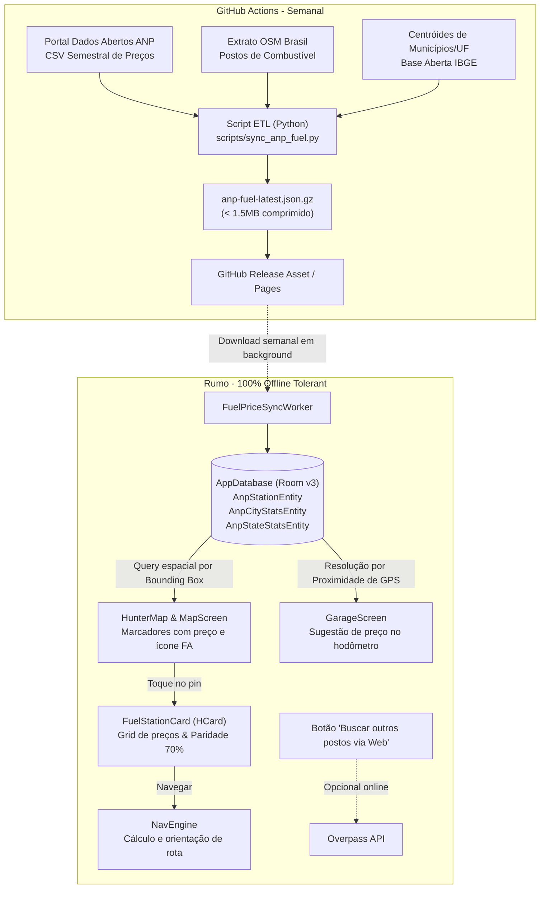

# Mini Projeto 6: Preços de Combustíveis (Série Histórica ANP & Postos no Mapa)

**Data:** 10 de novembro de 2026  
**Status:** Pronto para Aprovação do Usuário  
**Design System:** Novare (Midnight Navy / Clean Slate) com Font Awesome 6  
**Domínio:** Android (Kotlin, Jetpack Compose, Room), JVM puro (`core-model`, `navigation`), Ingestão de Dados (Python/ETL no GitHub Actions)

---

## 1. Contexto e Motivação

Durante viagens e deslocamentos de moto, o abastecimento é um elemento crítico do planejamento de rota e autonomia. O motociclista necessita:
1. Visualizar com clareza os postos ao redor no mapa, mesmo quando estiver em rodovias remotas sem sinal 4G/5G.
2. Identificar rapidamente o preço dos combustíveis (Gasolina Comum, Aditivada, Etanol, Diesel S10) para decidir a parada ideal.
3. Compreender a relação custo-benefício imediata entre Etanol e Gasolina (regra dos 70% de paridade de rendimento energético).
4. Contar com referências de preços sólidos (médias da cidade ou do estado) caso passe por regiões não cobertas pela pesquisa amostral semanal.
5. Manter o app rápido, responsivo (60 FPS) e com consumo zero de bateria/dados desnecessários durante a pilotagem.

A **ANP (Agência Nacional do Petróleo, Gás Natural e Biocombustíveis)** disponibiliza a *Série Histórica de Preços de Combustíveis* em seu portal de Dados Abertos (`https://www.gov.br/anp/pt-br/centrais-de-conteudo/dados-abertos/serie-historica-de-precos-de-combustiveis`), contendo coletas semanais por posto e combustível em centenas de cidades do Brasil.

---

## 2. Metas, Não-Metas e Anti-Metas

### 2.1 Metas (Goals)
- **Operação Offline-First:** Toda a base processada de postos, preços e médias de cidades/estados reside no banco de dados local Room (`AppDatabase`). Ao navegar pelo mapa em áreas rurais ou rodovias sem sinal, os postos e preços carregam instantaneamente a partir do disco local.
- **Hierarquia de Cobertura em 3 Níveis:**
  1. *Nível 1 (Posto exato):* Postos pesquisados na semana pela ANP exibem o preço real na bomba (ex: badge verde/laranja `R$ 5,79`).
  2. *Nível 2 (Média municipal):* Postos em cidades pesquisadas pela ANP que não receberam visita na semana exibem o preço médio apurado na cidade (ex: `~R$ 5,82` com tag *"Média municipal (Recife)"*).
  3. *Nível 3 (Média estadual - Decisão do Usuário):* Cidades pequenas e trechos de rodovia sem pesquisa municipal direta utilizam a média apurada para o Estado (ex: `~R$ 5,85` com tag *"Média estadual (SP)"*).
- **Visualização Otimizada no Mapa (`HunterMap`):**
  - Marcadores de postos com mini-badges estilizados contendo o valor do combustível principal (`fa_gas_pump`).
  - Carregamento espacial por *Bounding Box* (`lat/lon`) diretamente do Room, sem travar a interface e sem chamadas HTTP a cada movimento de câmera.
- **Card Detalhado do Posto (`FuelStationCard` em `HCard`):**
  - Nome fantasia, bandeira com `SquircleIcon` (Shell, Ipiranga, Petrobras/Vibra, etc.) e distância atual.
  - Tabela completa de preços: Gasolina Comum, Aditivada, Etanol e Diesel S10.
  - Termômetro de paridade Etanol vs. Gasolina (`StatusPill` informando percentual exato e qual combustível compensa financeiramente).
  - Indicação transparente da procedência do dado: data da coleta ANP ou tipo de média (municipal/estadual).
  - Ações diretas: "Navegar até o posto" e "Adicionar parada na rota".
- **Apoio Inteligente na Garagem (`GarageScreen`):**
  - Ao registrar um abastecimento no `AddFuelupDialog`, sugerir com 1 toque o preço do litro com base na localização atual do GPS.
- **Pipeline de Ingestão Automatizado (GitHub Actions):**
  - Workflow agendado (semanal) que baixa o arquivo da ANP, cruza coordenadas, agrega estatísticas municipais/estaduais, comprime o resultado em `< 1.5MB` (`anp-fuel-latest.json.gz`) e publica via GitHub Releases/Pages sem custo de servidor.

### 2.2 Não-Metas (Non-Goals)
- Fazer download e parsing do arquivo CSV bruto de centenas de megabytes no smartphone.
- Usar o Firestore para dados públicos de postos (preserva 100% da cota gratuita Spark).
- Bloquear a tela ou a navegação para aguardar atualizações de preços.
- Cadastro colaborativo manual de preços por usuários nesta fase.

### 2.3 Anti-Metas (Anti-Goals)
- Nunca fazer requisições à Overpass API em eventos contínuos de câmera (`onCameraIdle`), evitando bloqueios de IP (HTTP 429).
- Nunca induzir o motociclista a erro ocultando a data da coleta ou simulando preço exato onde há apenas média estatística.

---

## 3. Restrições Técnicas

- **Stack:** Kotlin 2.2.20, AGP 8.13.2, Jetpack Compose, Room v3, Material 3 com Design System Novare.
- **Módulos JVM Puros:** Lógica de negócio, paridade de combustível e cálculo de distâncias em `core-model` e `navigation`, 100% testáveis sem emulador.
- **Custo Zero:** Dados distribuídos via GitHub CDN estática; sincronização em background no Android via `WorkManager` (uma vez por semana ou sob demanda em Wi-Fi).
- **Idioma:** Estritamente `pt-BR`.

---

## 4. Abordagens Consideradas e Decisão

| Abordagem | Descrição | Prós | Contras | Veredito |
|---|---|---|---|---|
| **1. Apenas Postos Geocodificados ANP** | Plota apenas postos amostrados diretamente na ANP com coordenadas extraídas. | Preço sempre exato. | Ausência total de postos fora das grandes capitais. | Descartada |
| **2. Apenas Resumo Regional** | Apenas um resumo textual no topo do mapa. | Simples. | Não aproveita os postos reais no mapa. | Descartada |
| **3. Abordagem Híbrida em 3 Níveis (Escolhida)** | Base offline no Room com preços exatos de postos ANP + médias municipais + fallback de médias estaduais. | 100% offline, cobertura em todo o território nacional, excelente UX e performance a 60 FPS. | Requer agregação no ETL e matching espacial. | **Aprovada pelo usuário** |

---

## 5. Arquitetura do Sistema



---

## 6. Decisões de Arquitetura e Engenharia (Builder Calls)

1. **Room como Fonte Primária do Mapa:** A exibição de postos e preços no mapa consulta o banco Room local por bounding box (`minLat <= lat <= maxLat AND minLon <= lon <= maxLon`). Isso assegura funcionamento em 100% das rodovias sem internet e elimina engasgos.
2. **Geocodificação no Backend (GitHub Actions):** O script Python cruza o CSV da ANP com o extrato de postos de combustível do OpenStreetMap Brasil (`amenity=fuel`) e centróides de CEP/município em memória no CI, sem fazer requisições a APIs pagas e sem risco de ban no Nominatim.
3. **Resolução Espacial de Cidades e Estados Offline:** As tabelas `AnpCityStatsEntity` e `AnpStateStatsEntity` possuem coordenadas centrais (`lat`, `lon`). A identificação da cidade/estado a partir do GPS do celular é feita calculando a menor distância esférica (`Geo.distanceM`), rodando em menos de 1 milissegundo sem nenhuma chamada de rede.
4. **Proteção contra Rate-Limit da Overpass:** O arrasto e zoom do mapa não acionam a Overpass API. Postos adicionais online do OSM só são consultados se o usuário tocar explicitamente em *"Buscar outros postos na internet"*.
5. **Hierarquia Tripla de Preços:**
   - Preço do Posto (se houver correspondência exata de CNPJ/nome na ANP).
   - Preço Médio Municipal (se a cidade constar na pesquisa semanal da ANP).
   - Preço Médio Estadual (se a cidade não constar na amostragem semanal da ANP).

---

## 7. Modelagem de Dados

### 7.1 Esquema Room no Módulo `app`

```kotlin
@Entity(
    tableName = "anp_stations",
    indices = [
        Index(value = ["lat", "lon"]),
        Index(value = ["cityKey"])
    ]
)
data class AnpStationEntity(
    @PrimaryKey val id: String, // Hash ou CNPJ
    val nome: String,
    val bandeira: String,
    val cityKey: String,
    val uf: String,
    val endereco: String,
    val bairro: String,
    val cep: String,
    val lat: Double,
    val lon: Double,
    val precoGasolina: Double?,
    val precoGasolinaAdit: Double?,
    val precoEtanol: Double?,
    val precoDiesel: Double?,
    val dataColeta: String
)

@Entity(
    tableName = "anp_city_stats",
    indices = [Index(value = ["lat", "lon"])]
)
data class AnpCityStatsEntity(
    @PrimaryKey val cityKey: String, // ex: "sp_campinas"
    val uf: String,
    val municipio: String,
    val lat: Double,
    val lon: Double,
    val gasolinaAvg: Double?,
    val gasolinaMin: Double?,
    val gasolinaMax: Double?,
    val etanolAvg: Double?,
    val etanolMin: Double?,
    val etanolMax: Double?,
    val dieselAvg: Double?,
    val dieselMin: Double?,
    val dieselMax: Double?,
    val dataReferencia: String
)

@Entity(tableName = "anp_state_stats")
data class AnpStateStatsEntity(
    @PrimaryKey val uf: String, // ex: "SP", "PE"
    val lat: Double,
    val lon: Double,
    val gasolinaAvg: Double?,
    val etanolAvg: Double?,
    val dieselAvg: Double?,
    val dataReferencia: String
)
```

---

## 8. Lógica de Negócio (`core-model`)

### 8.1 Termômetro de Paridade Etanol vs. Gasolina (`FuelParityMath`)
```kotlin
object FuelParityMath {
    const val PARITY_THRESHOLD = 0.70 // 70% de equivalência energética

    fun calculateRatio(etanolPrice: Double, gasolinaPrice: Double): Double? {
        if (etanolPrice <= 0 || gasolinaPrice <= 0) return null
        return etanolPrice / gasolinaPrice
    }

    fun isEtanolAdvantageous(ratio: Double): Boolean = ratio <= PARITY_THRESHOLD

    fun formatParityDescription(ratio: Double): String {
        val pct = (ratio * 100).toInt()
        return if (isEtanolAdvantageous(ratio)) {
            "Etanol a $pct% da gasolina · Etanol compensa"
        } else {
            "Etanol a $pct% da gasolina · Gasolina compensa"
        }
    }
}
```

---

## 9. Interface do Usuário (Design System Novare & Font Awesome 6)

### 9.1 Marcador no Mapa (`HunterMap`)
- Pin compacto tipo pílula com cantos arredondados:
  - Fundo Midnight Navy (`#141C2B`) com micro-borda tonal (`#38BDF8` ou `#FF7A1A`).
  - Ícone vetorial Font Awesome `fa_gas_pump` (14dp).
  - Texto do preço em destaque:
    - Preço exato da bomba: **`R$ 5,79`**
    - Média municipal: **`~R$ 5,82`**
    - Média estadual: **`~R$ 5,85`**

### 9.2 Bottom Sheet / Modal do Posto (`FuelStationCard`)
Componente `HCard` exibido na base da tela ao selecionar um posto:
```
┌─────────────────────────────────────────────────────────────┐
│ [⛽ Squircle]  Auto Posto Shell Portal            [ Shell ] │
│                Av. Caxangá, 1200 · a 1,4 km de você         │
├─────────────────────────────────────────────────────────────┤
│  GASOLINA         ETANOL           DIESEL S10               │
│  R$ 5,79          R$ 4,12          R$ 5,65                  │
│                                                             │
│  [🌿 StatusPill: Etanol a 71% da gasolina · Gasolina vence] │
├─────────────────────────────────────────────────────────────┤
│  ℹ️ Pesquisa oficial ANP · Coletado em 08/11/2026           │
│                                                             │
│  [  Navegar até o posto  (RumoPrimaryButton)            ]   │
│  [  Adicionar como parada (RumoSecondaryButton)          ]  │
└─────────────────────────────────────────────────────────────┘
```

### 9.3 Apoio na Tela de Garagem (`GarageScreen`)
- No diálogo de novo abastecimento (`AddFuelupDialog`), ao abrir para registrar o hodômetro e os litros colocados:
  - O app consulta a cidade mais próxima via `FuelPriceRepository.getNearestCityStats(currentLat, currentLon)`.
  - Exibe um chip clicável: *"Preço médio recente em Recife: R$ 5,82/L"* que preenche o valor por litro automaticamente.

---

## 10. Plano de Verificação e Testes

1. **Testes Unitários de Negócio (JVM Puro):**
   - `FuelParityMathTest`: valida limites de 70%, divisão por zero e formatação semântica de textos.
   - `AnpPayloadParserTest`: valida a leitura e integridade do JSON consolidado gerado pelo ETL.
   - `FuelPriceRepositoryTest`: valida a resolução por bounding box e a seleção correta da hierarquia (Posto -> Cidade -> Estado).
2. **Testes de Persistência (Room):**
   - Inserção em lote de postos e estatísticas e consultas por coordenadas espaciais.
3. **Testes de Interface (Compose):**
   - Renderização do `FuelStationCard` nos temas Midnight Navy e Clean Slate.
4. **Verificação de Regressão e Build:**
   - `./gradlew :sync-core:test :app:testDebugUnitTest`
   - `./gradlew assembleRelease`
